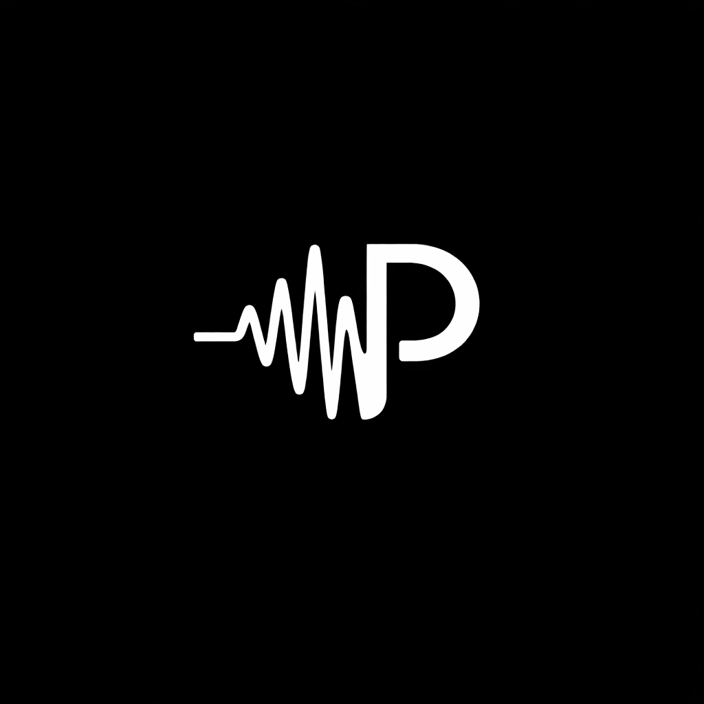

<div align="center">



# @prosodyai/sdk

TypeScript SDK for ProsodyAI.

Acoustic analysis of recorded and live speech: diarized turns, speaker
identity, per-speaker prosody measurements, and memory recall from one client.

[](https://www.npmjs.com/package/@prosodyai/sdk)
[](https://github.com/ProsodyAI/sdk/actions/workflows/ci.yml)
[](https://nodejs.org/)
[](https://www.typescriptlang.org/)
[](./LICENSE)

</div>

---

ProsodyAI measures the suprasegmental layer of speech: intonation, stress,
rhythm, and voice quality, the prosodic properties that span syllables and
phrases. The quantities are the ones the paralinguistics literature
standardized: F0 on a semitone scale, loudness in dBFS, voicing and pause
ratios, spectral tilt. Every measurement is speaker-relative. The same F0 is
emphatic for one voice and habitual for another, so the baseline is the
reference and the movement is the meaning.

This SDK exposes two transports, named after the API's own prefixes:

| Transport | Method | What it does |
| --- | --- | --- |
| **analyze** | `prosody.transcribe()`, `prosody.analyze()` | REST batch over `POST /v1/analyze/audio` |
| **stream** | `prosody.stream` | WebSocket at `WS /v1/stream/realtime`; you send PCM/Opus, events come back |

Around them sit the resources that outlive one call: `prosody.speakers` for
the speaker directory and enrollment, and `prosody.memory.recall` for a saved
person's significant moments.

## Features

- **Recorded transcription** with speaker diarization and prosody on by default
- **Realtime analysis** over a single WebSocket, paced by the model's codec frame clock
- **Measurement series**: `voiceFrames` and `measurementSeries` read one quantity across a call
- **Speaker identity** directory and a preview-then-confirm enrollment flow
- **Memory recall** of a saved person's significant moments
- **Acoustic IPA transcription**: timed phoneme segments read off the audio itself
- **Typed readouts**: `state` (what was measured) and `change` (what it moved), in family shape
- **Strict TypeScript**, zero runtime dependencies, ESM, tree-shakeable

## Installation

```bash
npm install @prosodyai/sdk
```

```bash
export PROSODY_API_KEY=psk_...
```

Create organization keys at [prosodyai.app](https://prosodyai.app/login).

## Quick start

### Recorded audio

```typescript
import { ProsodyClient } from '@prosodyai/sdk';

const prosody = new ProsodyClient({
  apiKey: process.env.PROSODY_API_KEY!,
});

const result = await prosody.transcribe('./call.wav');

for (const turn of result.turns) {
  console.log({
    speaker: turn.speaker.label,
    text: turn.text,
    pitch: turn.prosody?.state.intonation.pitch,
    loudness: turn.prosody?.state.stress.loudness,
    pitchChange: turn.prosody?.change?.intonation.pitch,
  });
}
```

`transcribe` accepts a local path, an HTTPS URL, or a Node.js `Buffer`.
Speaker diarization and prosody measurement are enabled by default.

### Realtime WebSocket

```typescript
const session = prosody.stream.session({
  encoding: 'pcm16',
  sampleRate: 16_000,
  onUpdate: (current) => render(current.snapshot()),
});

await session.start();
session.send(pcmChunk);
await session.stop();
```

Pace file replay against the server's frame ack:

```typescript
for (const chunk of chunks) {
  session.send(chunk);
  await session.waitForFrame();
}
```

## Speakers

```typescript
const [speaker] = result.speakers;

speaker.id;                              // stable within this call
speaker.label;                           // diarization label ("Speaker 1")
speaker.talkSeconds;                     // attributed speaking time
speaker.state.intonation.pitch?.median;  // their baseline pitch
speaker.state.stress.loudness?.median;   // their baseline loudness

result.getSpeaker(speaker.id);
result.turnsBySpeaker(speaker);
```

Diarization answers who spoke when: each turn and frame carries the label of
the speaker the model attributed it to. `speaker.id` is recording-local.
Durable cross-session identity is a separate resource. See
[Speaker directory and enrollment](#speaker-directory-and-enrollment).

## What a frame measures

A frame is one measured interval of the call, on the clock of the model's
streaming audio codec. Each frame reports the prosodic layer for one speaker
at one moment, in physical units.

```typescript
turn.prosody.state.intonation.pitch    // median F0, Hz
turn.prosody.state.intonation.range    // F0 span, semitones
turn.prosody.state.intonation.slope    // contour direction: rising or falling
turn.prosody.state.stress.loudness     // loudness, dBFS
turn.prosody.state.stress.peak         // loudest instant, dBFS
turn.prosody.state.rhythm.voiced       // voicing ratio, 0 to 1
turn.prosody.state.rhythm.pause        // pause ratio, 0 to 1
turn.prosody.state.rhythm.onset        // phonation onsets per second
turn.prosody.state.tilt                // voice quality: spectral tilt
turn.prosody.state.clipping           // signal health
```

A field is `null` when the audio did not support the measurement. Pitch is
`null` on an unvoiced frame, because F0 does not exist on unphonated audio.

`turn.prosody.change` carries the signed movement against the speaker's own
preceding audio, the same families and names as `state`:

```typescript
turn.prosody.change?.intonation.pitch   // semitones against baseline
turn.prosody.change?.stress.loudness    // dB against baseline
```

## Frames

`result.frames` lists the measured frames of the call in order. Each frame
is attributed to a speaker and carries its state, its change, and its
emotional-attribute reading:

```typescript
for (const frame of result.frames) {
  frame.speakerId;                 // the speaker this frame was attributed to
  frame.startMs;                   // where it sits on the call clock
  frame.state.intonation.pitch;    // how they sounded
  frame.change?.intonation.pitch;  // how they moved
  frame.vad;                       // valence/arousal/dominance, when available
}
```

`frame.vad` is the dimensional affect reading of the speech emotion
literature: valence (negative to positive), arousal (calm to active), and
dominance (weak to strong). Each component is `null` on an unvoiced frame.

## Measurement series

For the raw batch result, `voiceFrames` returns the measured frames and
`measurementSeries` reads one quantity across the call by its family path,
skipping frames where it was not measurable:

```typescript
import { measurementSeries, voiceFrames } from '@prosodyai/sdk';

const raw = await prosody.analyze('./call.wav');

voiceFrames(raw);                           // measured frames, in order
measurementSeries(raw, 'intonation.pitch'); // [{ start_ms, end_ms, speaker_id, value }, …]
measurementSeries(raw, 'stress.loudness');
```

## Phonetics

`prosody.ipa` transcribes what the audio *sounds like*: IPA symbols with
their timings, read off the acoustic stream itself — no transcript, no
dictionary. One 80ms frame is roughly one phoneme, so "nope" versus "mope"
is decided by the word-initial nasal's spectrum:

```typescript
const result = await prosody.ipa('./nope.wav');

result.ipa;       // "noʊp"
result.segments;  // [{ ipa: 'n', start_s: 0, end_s: 0.16, confidence: 0.91 }, …]
```

Each segment is one symbol's run on the 80ms grid with its mean posterior
confidence. Word boundaries arrive as spaces, so `result.ipa` reads as
spaced words. The head is a CTC classifier on frozen Mimi latents, trained
against silver labels from a wav2vec2 phoneme recognizer; the eval report
(per-phoneme error rate and the nasal confusions) publishes alongside the
model.

## Speaker directory and enrollment

```typescript
const directory = await prosody.speakers.list();
const preview = await prosody.speakers.previewEnrollment('./enroll.wav');

await prosody.speakers.confirmEnrollment(
  './enroll.wav',
  preview.preview_sha256,
  preview.lanes.map((lane) => ({
    speaker_id: lane.speaker_id,
    display_name: nameFor(lane),
  })),
);
```

Enrollment uses a preview-confirm transaction. Preview returns the speakers
detected in the recording; confirm persists the supplied mappings. This is
where durable, cross-session `person_id` identity comes from, distinct from
the recording-local `speaker.id` on a `Transcription`.

## Memory recall

A saved person's significant moments, recency-ranked, each with the measured
facts that selected it:

```typescript
const recall = await prosody.memory.recall.post(personId, 5);

for (const moment of recall.memories) {
  moment.metadata.at_ms;              // onset on its session's clock
  moment.metadata.significance;       // magnitude of the measured state delta
  moment.metadata.text;               // words around the moment
}
```

## Configuration

```typescript
const prosody = new ProsodyClient({
  apiKey: process.env.PROSODY_API_KEY!,
  headers: { 'X-Trace-Id': traceId },
  debug: true,
});
```

`baseUrl`, `timeoutMs`, and `retry` are optional and have sensible defaults. The client also accepts a bare key: `new ProsodyClient('psk_...')`.

## Error handling

```typescript
import { ProsodyClient, AuthenticationError, RateLimitError } from '@prosodyai/sdk';

try {
  await prosody.transcribe('./call.wav');
} catch (error) {
  if (error instanceof AuthenticationError) {
    // 401: the API key is missing or invalid
  } else if (error instanceof RateLimitError) {
    // 429: retry with backoff
  }
}
```

## Requirements

- Node.js 18 or newer
- A ProsodyAI API key (`psk_*`)

## Documentation

- [Quickstart](https://prosodyai.app/docs/quickstart)
- [ProsodyClient](https://prosodyai.app/docs/reference)
- [Speaker](https://prosodyai.app/docs/reference/speaker)
- [Prosody](https://prosodyai.app/docs/reference/prosody)
- [LiveSession](https://prosodyai.app/docs/reference/live-session)
- [Live analysis](https://prosodyai.app/docs/live)

## Contributing

See [CONTRIBUTING.md](./CONTRIBUTING.md). Run the suite from the package root:

```bash
npm run build      # tsc into dist/
npm run typecheck  # tsc --noEmit
npm test           # vitest run
```

## License

MIT. See [LICENSE](./LICENSE).
